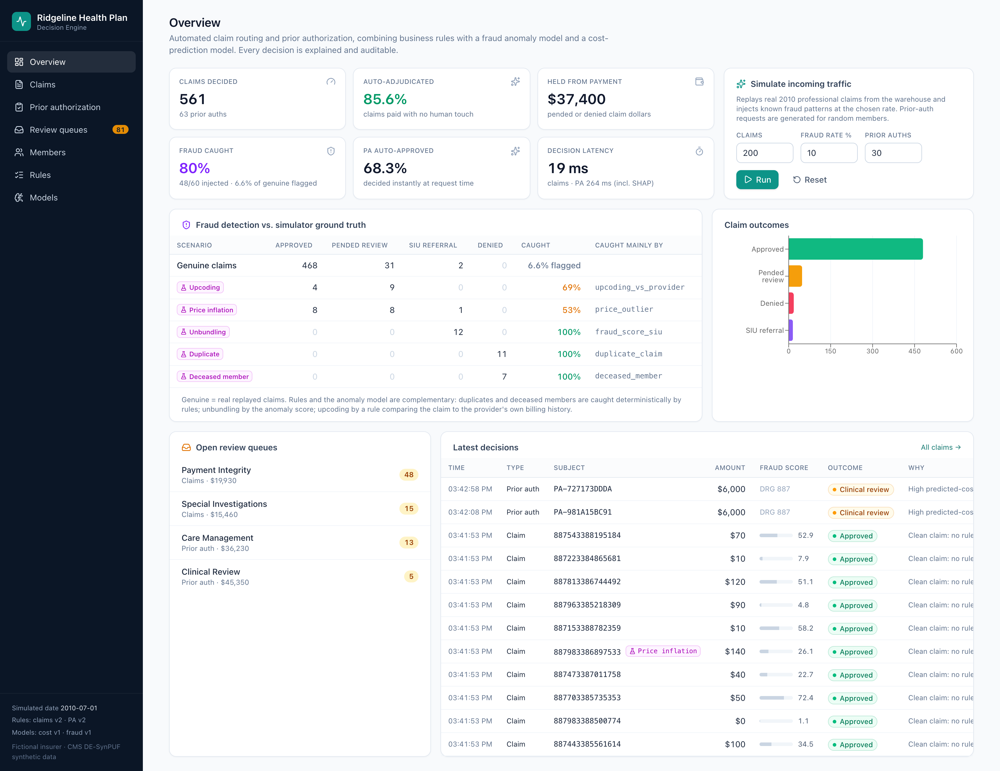
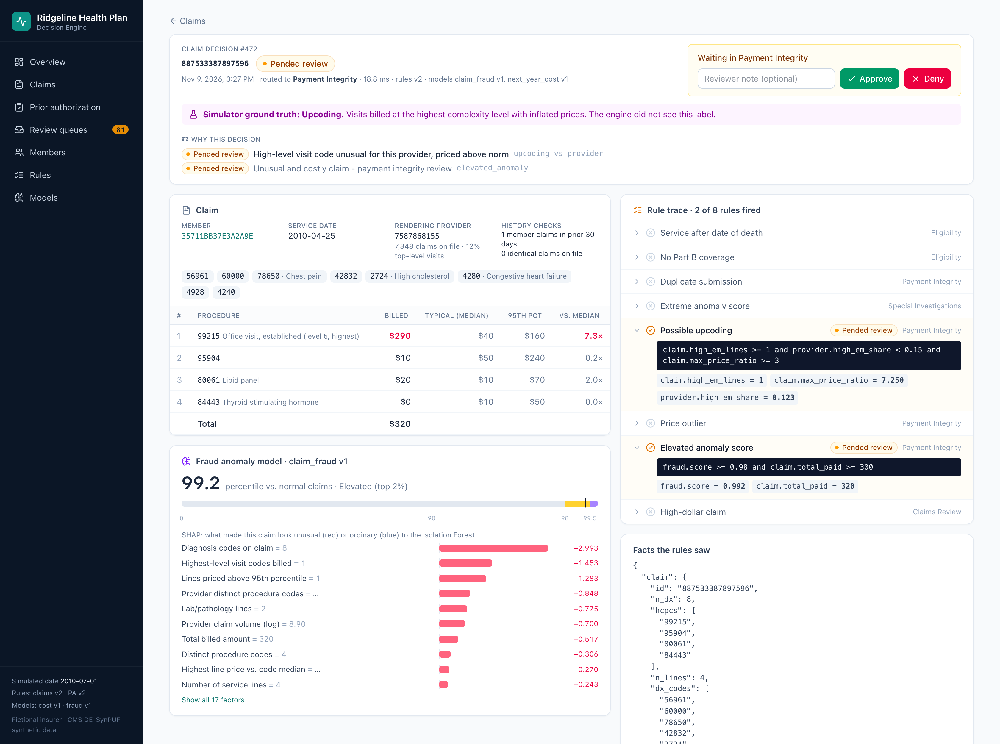
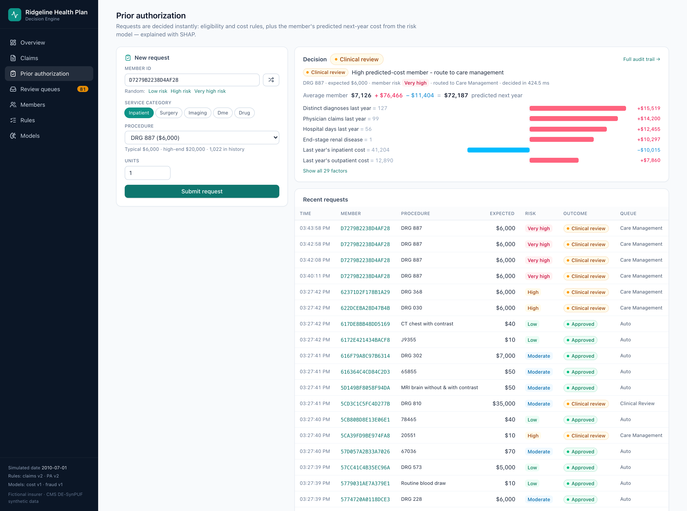
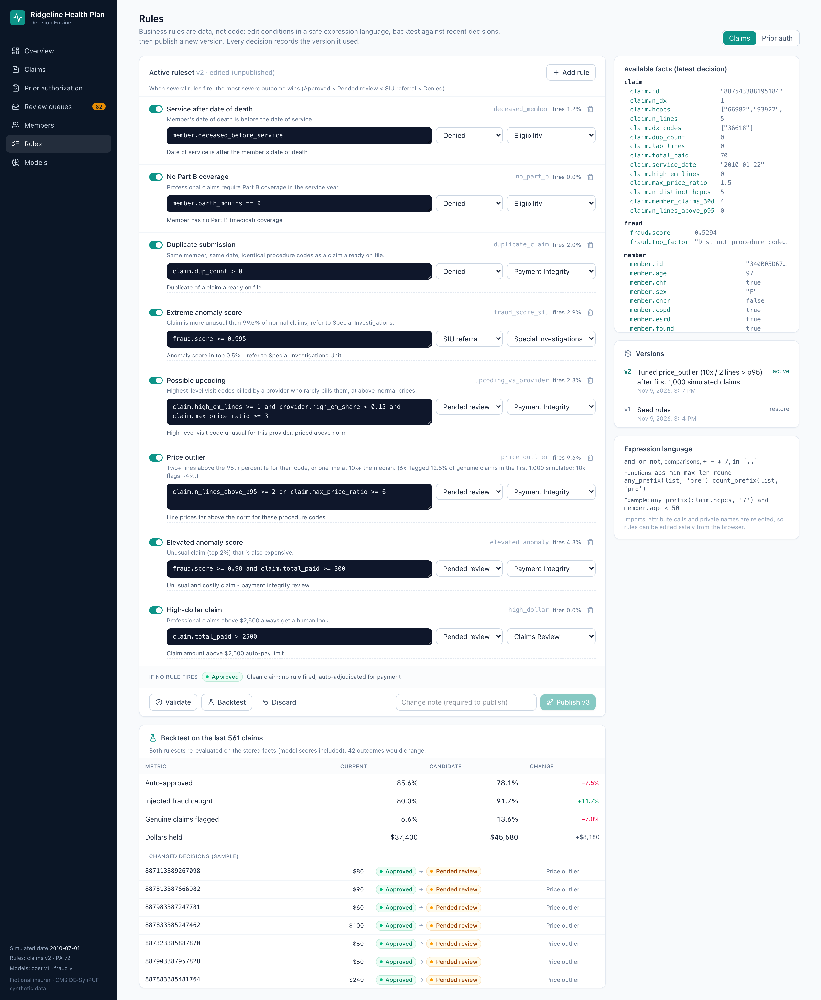
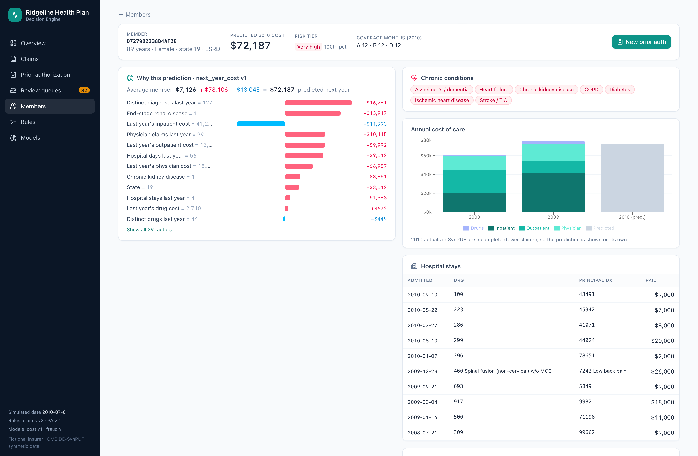
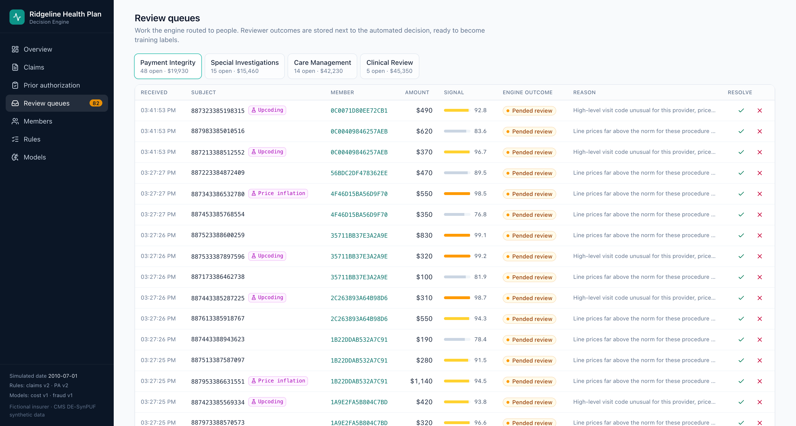
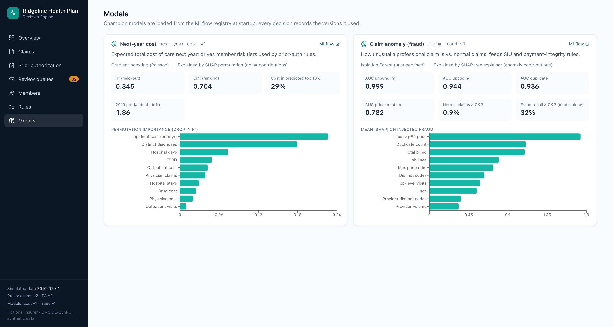

# decision-engine

Automated claim routing and prior authorization for a fictional insurer, **Ridgeline Health
Plan**: a rules engine that combines a fraud anomaly model and a cost-prediction model, with
SHAP explanations and a full audit trail for every decision. Plus a web app to demo it.
Data: the shared SynPUF warehouse in `~/sources/medical-dw` (Postgres :55433, MLflow :5050).



## Screenshots

**Claim decision** — every decision is explained: line prices vs. code norms, the anomaly score with
SHAP contributions, which rules fired with the exact values they saw, and a reviewer Approve/Deny.



**Prior authorization** — decided instantly; the member's predicted next-year cost is explained in
dollars (average member + contributions = prediction) and drives care-management routing.



**Rules editor + backtest** — rules are data in a sandboxed expression language. Loosening the price
rule from 10× to 6× catches more fraud but doubles genuine claims sent to review, measured on stored
decisions before anything is published.



**Member risk** — cost-model prediction with SHAP, chronic conditions, cost history and hospital stays.



| Review queues | Models (from the MLflow registry) |
|---|---|
|  |  |

<sub>Screenshots: `node docs/capture_screenshots.mjs` (headless Chrome at 2×). All data is synthetic (CMS DE-SynPUF); the insurer is fictional.</sub>

## Run it

```bash
cd ~/sources/medical-dw && docker compose up -d            # Postgres + MLflow
cd ~/sources/decision-engine
uv run uvicorn engine.api:app --port 8000 --reload          # API (docs: localhost:8000/docs)
npm run dev --prefix web                                    # web app: localhost:5173
```
(In Claude Code the `api` and `web` launch configs in `.claude/launch.json` do the same.)
First-time setup (already done here): `uv run python -m cost_model.dataset && uv run python -m cost_model.train`,
`uv run python -m fraud_model.reference && uv run python -m fraud_model.train`, `npm install --prefix web`.

### 3-minute demo
1. **Overview** → *Run* (e.g. 400 claims, 10% fraud, 30 PAs). Watch auto-adjudication rate, dollars held,
   and the *fraud detection vs. ground truth* table: which injected patterns were caught, by which rule.
2. Click an **Upcoding** row → open a claim: line prices vs. code norms, anomaly score + SHAP bars,
   the full rule trace with the exact values each condition saw, and reviewer Approve/Deny.
3. **Prior authorization** → pick a *Very high risk* member and an inpatient DRG → instant decision with
   the member's predicted cost explained in dollars (base + SHAP contributions = prediction).
4. **Rules** → change `price_outlier` from `>= 10` to `>= 6` → *Backtest*: fraud caught ↑, genuine flagged ×2.
   That trade-off is the reason the threshold is 10. Publish creates a new version; every decision stores its version.
5. **Review queues** / **Members** / **Models** for the human side, member risk, and model cards (linked to MLflow).

## How it works

```
claim / PA request ──► facts builder ──► models ──────────► rules engine ──► decision + audit record
                       (Postgres:        claim_fraud         (versioned,       outcome, queue, reasons,
                        history, member, (Isolation Forest)  safe expression   facts, SHAP, rule trace,
                        provider, price  next_year_cost      language)         model+rule versions
                        norms)           (GBM) + SHAP
```
- `engine/` — FastAPI app (`api.py`), decision service (`service.py`), rules engine (`rules.py`),
  model loading + SHAP (`models.py`), traffic simulator (`simulator.py`), seed rules (`default_rules.yaml`).
- `fraud_model/` — shared claim features (`features.py`, used by training *and* live scoring),
  fraud injection (`injection.py`), reference tables (`reference.py`), training (`train.py`).
- `cost_model/` — next-year cost dataset + training (below).
- `web/` — React + Vite + Tailwind + TanStack Query + Recharts.
- Postgres schema `decision_engine`: `decision` (every decision with facts/explanations/trace),
  `ruleset` (versions), `incoming_claim`, `member_risk`, `member_snapshot`, `ref_*` price/provider norms.

The engine's "world": history = 2008–09 claims, incoming claims are real 2010 claims replayed by the
simulator (some altered with injected fraud), today = 2010-07-01. SynPUF has no fraud labels, so the
injected scenario is stored as ground truth (`decision.injected`) — never shown to the engine.

**Why rules + models:** the anomaly model ranks fraud well (AUC 0.94–0.999) but at a strict threshold
catches only ~30% of injected fraud by itself; rules catch duplicates and deceased members exactly and
detect upcoding *relative to the provider's own history*. Together (rules v2): ~95% of injected fraud
caught with ~5–6% of genuine claims sent to review.

Caveats: synthetic data (relationships between columns are weakened); SynPUF professional fees are small
(imaging ≈ $40), so PA rules use categories more than dollar thresholds; code descriptions in
`engine/codes.py` are short paraphrases for display.

## Step 1 — next-year cost model

Predict a beneficiary's total cost of care in year t+1 from year t
(demographics, 11 chronic conditions, prior-year cost and utilization).
This is the building block for 20-year projections (chain year-ahead predictions).

```bash
uv sync
uv run python -m cost_model.dataset     # ~4 min: DuckDB over all 20 samples -> data/next_year_cost.parquet
uv run python -m cost_model.train       # ~1 min: 4 models -> MLflow; best becomes next_year_cost@champion
```

Population: full-year Part A+B fee-for-service beneficiaries alive at end of year t.
Target: Medicare + beneficiary + other-payer paid (IP/OP/carrier) + Part D drug cost, in t+1.

Evaluation:
- **valid** — 20% of beneficiaries held out, 2008→2009 (same period as training → model quality)
- **test** — 2009→2010 (next period → quality + drift). SynPUF 2010 is thinner
  (mean target $4.1k vs $7.1k), so dollar metrics break on test; ranking metrics hold up better.

### First results (2026-11-04)

| model | valid R² | valid Gini | top-10% capture | test Gini | test pred/actual |
|---|---|---|---|---|---|
| mean_baseline | 0.00 | — | 9% | — | 1.73 |
| linear_demo_chronic | 0.21 | 0.62 | 25% | 0.48 | 1.87 |
| gbm_demo_chronic | 0.22 | 0.63 | 26% | 0.49 | 1.92 |
| **gbm_full** (champion) | **0.35** | **0.70** | **29%** | **0.57** | 1.86 |

Takeaways: prior-year utilization adds most of the lift (inpatient cost, diagnosis breadth,
inpatient days); a GBM over chronic flags alone barely beats a linear model; the 2010
level shift (predictions ~1.9× actual) is drift, which needs recalibration, not a better model.

Using the model from code:
```python
import mlflow; mlflow.set_tracking_uri("http://localhost:5050")
model = mlflow.pyfunc.load_model("models:/next_year_cost@champion")
model.predict(features_df)   # columns per the model signature (see MLflow UI)
```
